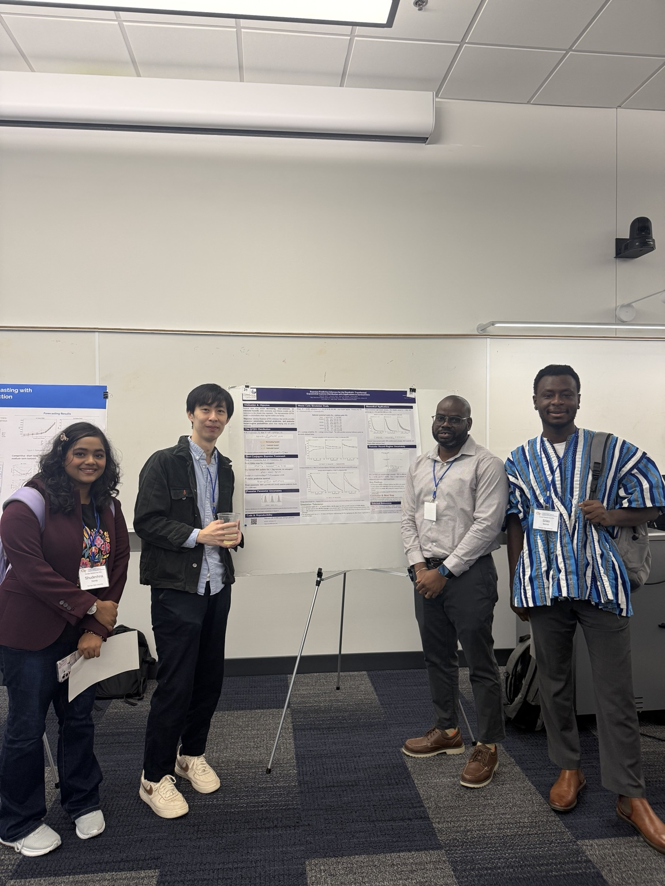

<p class="eyebrow">Conferences and research communication</p>
<p class="lede">Research presentations and conference participation.</p>

## Research presentations

::: {.cv-entry}
<p class="meta">November 18, 2026 · Georgia State University</p>

### 5th Annual Graduate Conference for Research, Scholarship, and Creative Activity

**Institution:** Georgia State University, The Graduate School.  
**Presentation format:** Research poster.

**Poster title:** *Beyond Quantile Agreement: Decomposing Expected Shortfall Discrepancies in Fire-Loss Models.*

**Topic:** A diagnostic framework for assessing where fitted extreme-loss models and empirical loss distributions disagree, using Expected Shortfall decomposition and bounded insurance layers.

**Status:** Presented on November 18, 2026.

**Poster authors:** Silas Bambil, Shudeshna Nandy, Clement Ampong, and Prakash Karki. **Faculty advisor:** Chi-Kuang Yeh.

[Research description](research.qmd#fire-loss) · [Computational methods](projects.qmd#nfirs-analysis) · [Poster references](evt-fireloss-references.qmd)
:::

## Conference attendance

::: {.conference-feature}
::: {.conference-photo}
```{=html}
<figure>
<a href="assets/georgia-statistics-day.jpeg" target="_blank" rel="noopener noreferrer" aria-label="View Georgia Statistics Day photograph">

</a>
<figcaption>Georgia Statistics Day.</figcaption>
</figure>
```
:::
::: {.conference-copy}
### Georgia Statistics Day

Attended Georgia Statistics Day.
:::
:::
