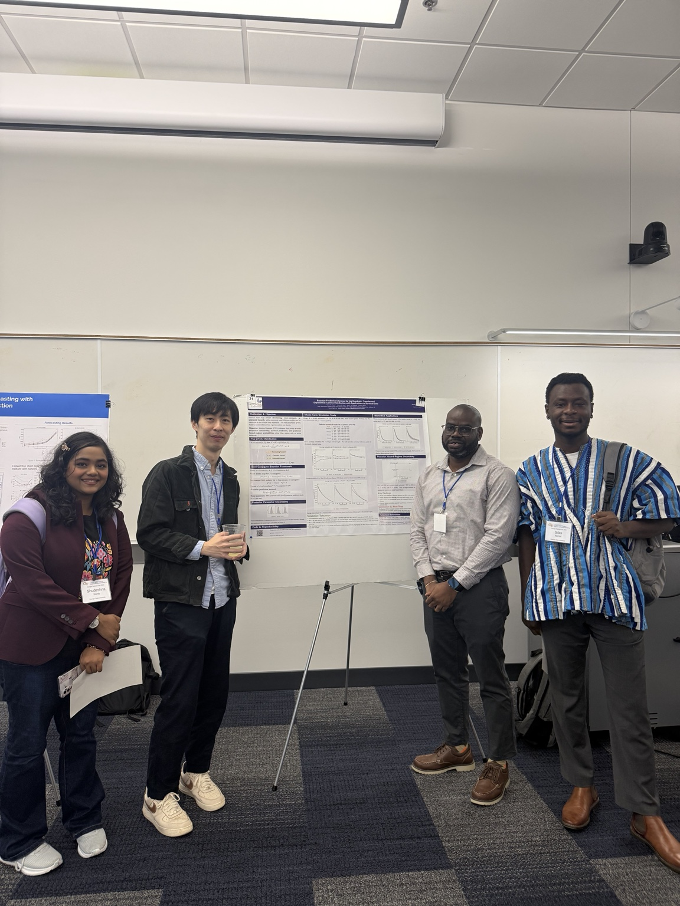

<p class="eyebrow">Conferences and research communication</p>
<p class="lede">This page distinguishes scheduled presentations from completed conference attendance. A scheduled presentation is not listed as a completed presentation.</p>

## Scheduled presentation

::: {.cv-entry}
<p class="meta">November 18, 2026 · Georgia State University</p>

### Georgia State University Graduate Conference

**Presentation format:** Research poster (registered).

**Research:** *Beyond Quantile Agreement: Decomposing Expected Shortfall Discrepancies in Fire-Loss Models.*

**Topic:** A diagnostic framework for assessing where fitted extreme-loss models and empirical loss distributions disagree, using Expected Shortfall decomposition and bounded insurance layers.

**Status:** Scheduled; not yet presented.

The underlying manuscript lists Silas Bambil, Shudeshna Nandy, Clement Ampong, Prakash Karki, and Chi-Kuang Yeh as authors. This does not establish the final conference program's presenter or coauthor listing.
:::

## Conference attendance

::: {.conference-feature}
::: {.conference-photo}
```{=html}
<figure>
<a href="assets/georgia-statistics-day.jpeg" target="_blank" rel="noopener noreferrer" aria-label="View Georgia Statistics Day photograph">

</a>
<figcaption>Georgia Statistics Day.</figcaption>
</figure>
```
:::
::: {.conference-copy}
### Georgia Statistics Day

Attended Georgia Statistics Day. No research presentation is claimed for this event.
:::
:::
