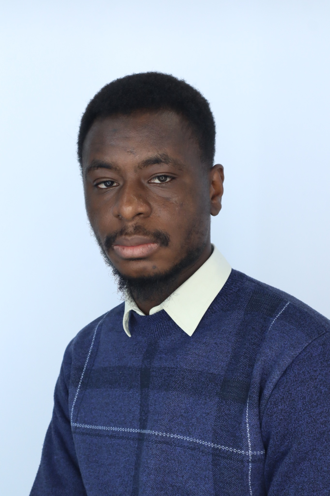
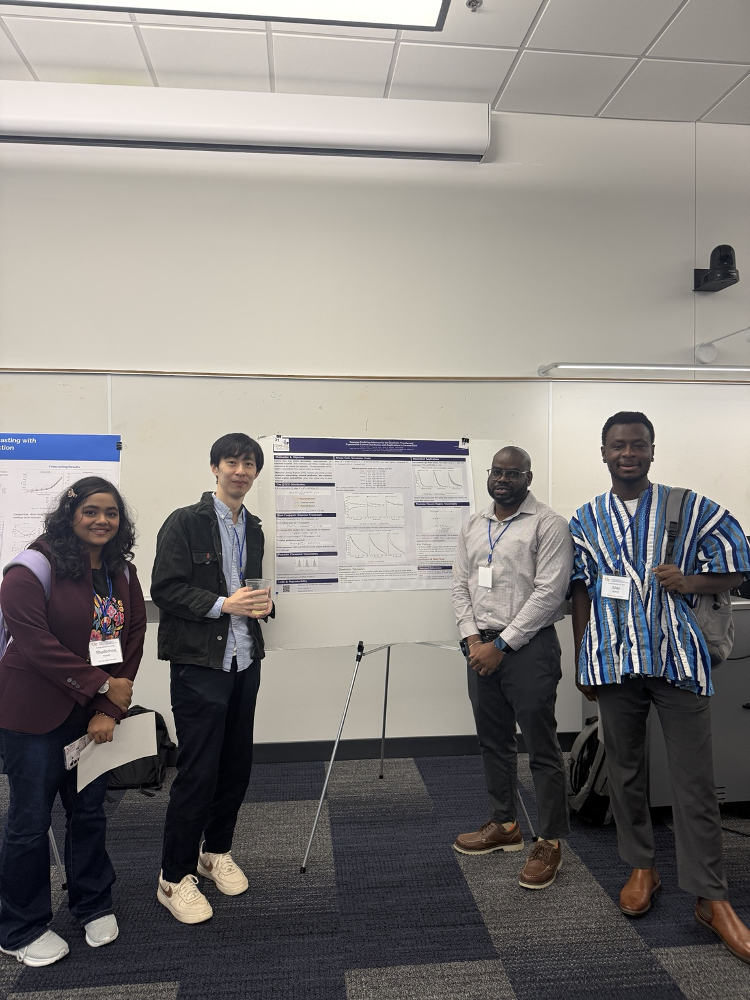

:::: {.academic-layout}
::: {.profile-rail}
```{=html}
<div class="profile-bio" role="complementary" aria-label="About Silas Bambil">

<p class="profile-name">Silas Bambil</p>
<p class="profile-role">Graduate student in Statistics<br>Georgia State University</p>
<p class="profile-location">Atlanta, Georgia</p>
<div class="profile-contact"><a href="mailto:sdbambil98@gmail.com">Email me</a><a href="https://github.com/sdbambil1">GitHub ↗</a><a href="files/Silas_Bambil_PhD_CV.pdf">CV · PDF ↓</a></div>
<div class="rail-note"><span class="eyebrow">Areas of interest</span><p>Statistical prediction<br>Model calibration<br>Extreme value theory<br>Quantitative risk</p></div>
</div>
```
:::

::: {.academic-main}
<p class="eyebrow">Statistics & quantitative risk</p>

# About me

My work begins with a deceptively simple question: **how much confidence should we place in a prediction when the world around it changes?**

I study probability calibration, model adaptation, and extreme risk. A model may still distinguish higher risks from lower ones while assigning unreliable probabilities—a subtle distinction with substantial consequences. Alongside this work, I use extreme value theory to examine rare losses and the uncertainty that gathers in the far tail.


[Full curriculum vitae →](cv.qmd){.text-link}

## Current work

::: {.work-entry}
<p class="meta">01 / Predictive modeling · Unpublished manuscript, 2026</p>

### Prediction under distribution shift

With Shudeshna Nandy, I examine calibration, discrimination, and decision thresholds in credit-risk models, comparing updating strategies through simulation and a loan-default benchmark.

[Research summary](research.qmd#distribution-shift) · [Related software](projects.qmd#shiftadapt)
:::

::: {.work-entry}
<p class="meta">02 / Extreme value theory · Unpublished manuscript, 2026</p>

### Fire-loss severity and far-tail uncertainty

An analysis of approximately 1.25 million U.S. structure-fire loss records, exploring the stability of extreme quantiles and the sensitivity of Expected Shortfall.

[Research summary](research.qmd#fire-loss) · [Analysis code ↗](https://github.com/sdbambil1/nfirs-extreme-value-analysis)
:::

::: {.work-entry}
<p class="meta">03 / Statistical computing · In development</p>

### shiftadapt

An R package for logistic model updating and intervention selection under distribution shift, with separate data for fitting, selection, and final evaluation.

[Software & projects →](projects.qmd)
:::

## Teaching

I support College Algebra students as a Graduate Lab Assistant at Georgia State University. Previously, I taught AP Calculus, AP Precalculus, and AP Statistics at Osceola School for the Arts.

[Courses & teaching experience →](teaching.qmd)

## Beyond the desk {#conferences}

::: {.conference-feature}
::: {.conference-photo}
```{=html}
<figure>
<a href="assets/georgia-statistics-day.jpeg" target="_blank" rel="noopener noreferrer" aria-label="View the full Georgia Statistics Day photograph">

</a>
<figcaption>Attending Georgia Statistics Day.</figcaption>
</figure>
```
:::
::: {.conference-copy}
<p class="eyebrow">Conference attendance</p>

### Georgia Statistics Day

I recently attended Georgia Statistics Day.

[View photograph ↗](assets/georgia-statistics-day.jpeg){target="_blank" rel="noopener noreferrer"}
:::
:::

::: {.contact-band}
### Get in touch

I welcome conversations about statistical prediction, quantitative risk, and potential research collaborations.

[Contact me →](contact.qmd)
:::
:::
::::
